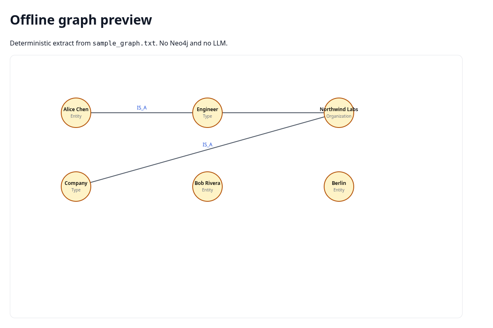

# LLM Graph Builder

[English](./README.md) | **简体中文**

许可证未改。

## 离线图预览

可以把本地文本预览成图 JSON（节点/边），不必连接 Neo4j，也不必调用在线模型。

```bash
python -m pytest tests/test_offline_preview.py
```

Neo4j 配置仍然只从环境变量读取。请不要提交密钥。若 git 历史里还有旧密码，需要仓库所有者去轮换。


