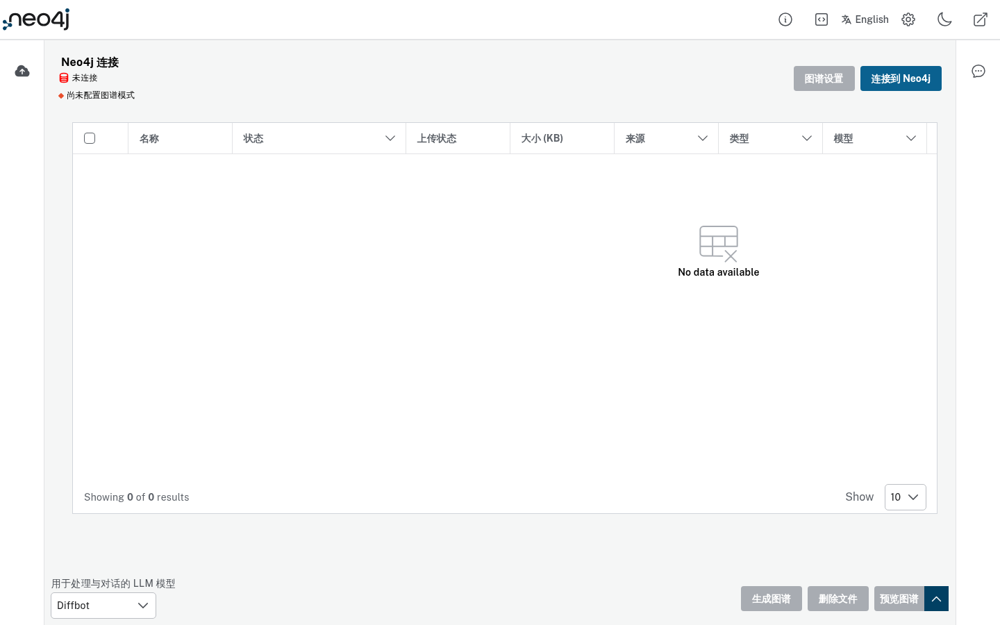
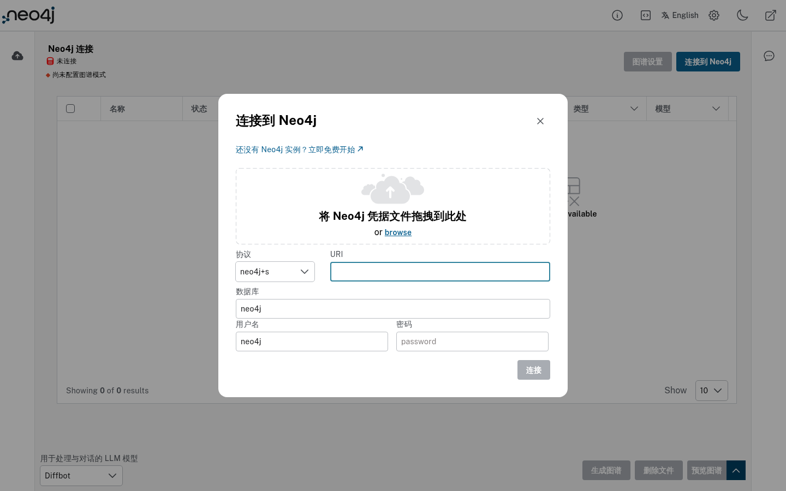

# 知识图谱构建器（Knowledge Graph Builder）


[English](README.md) · **简体中文**

借助大语言模型（LLM）和 LangChain 框架，把非结构化数据（PDF、DOC、TXT、YouTube 视频、网页等）转换为存储在 Neo4j 中的结构化知识图谱。

你可以从多种来源（本地、GCS、S3 存储桶或网页）上传文件，选择偏好的 LLM 模型，然后生成知识图谱。

## 🖥️ 桌面版（一键离线）

想要**点开即用**？这里提供跨平台的一键桌面应用：双击启动即自动拉起内置后端并加载界面，运行环境**全部内置、首次启动无需联网**，界面**默认中文**（右上角可切 English），并内置「**系统设置**」面板，可在界面里直接配置大模型（含 OpenAI 兼容 / 自定义，如 **DeepSeek**、Kimi、智谱等）与系统选项。

- 直接下载（Windows / Linux / macOS）：<https://github.com/gatesenman/llm-graph-builder/releases>（目前尚未发布版本，可按 `desktop/README.md` 自行构建）
- 构建方式、离线运行原理与系统设置说明：[`desktop/README.md`](desktop/README.md)

> 桌面应用未内置 Neo4j 数据库，启动后在「连接到 Neo4j」对话框填入本地或 [Neo4j Aura](https://console.neo4j.io/)（免费版）实例即可。

## 界面截图

以下截图来自前端开发服务器（`cd frontend && yarn && yarn run dev`），用无头 Chromium 拍摄；未启动后端、未连接 Neo4j，因此文件列表为空：

| 主界面（中文） | 连接到 Neo4j |
| --- | --- |
|  |  |

## 快速开始

### 前置条件
- **Python 3.12 或更高版本**（本地 / 前后端分离部署后端时需要）
- Neo4j 数据库 **5.23 或更高版本**，并安装 APOC。
  - 需要 Neo4j 5.23，因为后端使用了变量作用域子查询语法（`CALL (variable) { ... }`），5.20 等更早的 5.x 版本不支持。
  - 支持 **Neo4j Aura**（含免费版）。
  - 使用 **Neo4j Desktop** 时需要分别部署后端和前端（不支持 docker-compose）。

### 后端
1. 复制 `backend/example.env` 为 `backend/.env`。
2. 在 `.env` 中预置数据库凭据即可跳过登录对话框：
   ```bash
   NEO4J_URI=<your-neo4j-uri>
   NEO4J_USERNAME=<your-username>
   NEO4J_PASSWORD=<your-password>
   NEO4J_DATABASE=<your-database-name>
   ```
3. 运行：
   ```bash
   cd backend
   python3.12 -m venv venv
   source venv/bin/activate  # Windows：venv\Scripts\activate
   pip install -r requirements.txt
   uvicorn score:app --reload
   ```

### 前端
1. 复制 `frontend/example.env` 为 `frontend/.env`，按需修改。
2. 运行：
   ```bash
   cd frontend
   yarn
   yarn run dev
   ```

### Docker Compose

在仓库根目录用默认的 `docker-compose.yml` 同时启动前后端：

```bash
docker-compose up --build
```

- **模型**：默认只启用 OpenAI 和 Diffbot，Gemini 需要额外的 GCP 配置。用 `VITE_LLM_MODELS_PROD` 配置需要的模型，例如 `VITE_LLM_MODELS_PROD="gemini_3.5_flash,openai_gpt_5.4_mini,diffbot,anthropic_claude_4.5_haiku"`。
- **Anthropic 模型**：例如 `LLM_MODEL_CONFIG_ANTHROPIC_CLAUDE_4_7_OPUS="claude-opus-4-7,anthropic_api_key"`。
- **数据来源**：默认启用 `local`、YouTube、Wikipedia、AWS S3 和 `web`。要加入 Google Cloud Storage，请加上 `gcs` 和 Google Client ID：`VITE_REACT_APP_SOURCES="local,youtube,wiki,s3,gcs,web"`、`VITE_GOOGLE_CLIENT_ID="your-google-client-id"`。
- **对话模式**：用 `VITE_CHAT_MODES` 配置。默认全部启用：`vector`、`graph_vector`、`graph`、`fulltext`、`graph_vector_fulltext`、`entity_vector`、`global_vector`；例如只启用部分：`VITE_CHAT_MODES="vector,graph"`。

## 主要功能

### 知识图谱构建
- 利用先进的 LLM 把非结构化数据转换为结构化知识图谱。
- 抽取节点、关系及其属性，构建结构化图谱。

### Schema 支持
- 使用自定义 schema，或在设置中配置的已有 schema 来生成图谱。

### 图谱可视化
- 在 **Neo4j Bloom** 中同时查看单个或多个数据源的图谱。

### 与数据对话
- 通过对话式查询与 Neo4j 中的数据交互。
- 获取回答来源的元数据。
- 独立的对话界面可使用 **[/chat-only](/chat-only) 路由**。

### 支持的 LLM
1. OpenAI
2. Gemini
3. Diffbot
4. Azure OpenAI（开发部署版）
5. Anthropic（开发部署版）
6. Fireworks（开发部署版）
7. Groq（开发部署版）
8. Amazon Bedrock（开发部署版）
9. Ollama（开发部署版）
10. DeepSeek（开发部署版）
11. 其他 OpenAI 兼容 Base URL 的模型（开发部署版）

### Token 用量追踪
- 按用户和数据库连接监控 LLM token 用量。
- 在后端配置中把 `TRACK_USER_USAGE` 设为 `true` 即可启用。
- 查看每日 / 每月的 token 消耗和额度，避免超额。
- 可随时通过提供的 API 端点查询剩余额度。

### 选择嵌入模型
- 可在前端 **Graph Settings > Processing Configuration > Select Embedding Model** 中选择生成向量嵌入的模型。
- 支持 OpenAI、Gemini、Amazon Titan 和 Sentence Transformers。
- 启用 `TRACK_USER_USAGE` 时，所选嵌入模型会保存到用户配置中。

#### 本地配置
1. **启用用户追踪（`TRACK_USER_USAGE=true`）**：在后端 `.env` 中设置 `TRACK_USER_USAGE=true` 并提供 token 追踪数据库凭据（`TOKEN_TRACKER_DB_URI`、`TOKEN_TRACKER_DB_USERNAME` 等），然后在前端选择嵌入模型，之后的会话会自动沿用。
2. **不启用用户追踪（`TRACK_USER_USAGE=false`）**：在后端 `.env` 中用 `EMBEDDING_MODEL` 和 `EMBEDDING_PROVIDER` 直接指定模型与提供方；未设置时默认使用 Sentence Transformer 模型。此模式下无法在前端更改嵌入模型。

## 本地 LLM（Ollama）
1. 拉取 Ollama 镜像：`docker pull ollama/ollama`
2. 运行：`docker run -d -v ollama:/root/.ollama -p 11434:11434 --name ollama ollama/ollama`
3. 运行任意模型，例如 llama3：`docker exec -it ollama ollama run llama3`
4. 在 docker compose 中配置环境变量：
   ```env
   LLM_MODEL_CONFIG_ollama_<model_name>
   # 示例
   LLM_MODEL_CONFIG_ollama_llama3=${LLM_MODEL_CONFIG_ollama_llama3-llama3,http://host.docker.internal:11434}
   ```
5. 配置后端 API 地址：`VITE_BACKEND_API_URL=${VITE_BACKEND_API_URL-backendurl}`
6. 在浏览器中打开应用，选择 Ollama 模型进行抽取。

## 使用方法
1. 连接 Neo4j 实例（AURA DS 或 AURA DB）：可以通过后端环境变量传入 URI 和密码、在登录对话框中填写，或拖入 Neo4j 凭据文件。
2. 「Neo4j 连接」标签下用不同图标区分：AURA DB 显示数据库图标，AURA DS 显示分子图标。
3. 从非结构化数据来源列表中选择来源。
4. 如有需要，在下拉框中切换用于生成图谱的 LLM。
5. 可选：在实体图谱抽取设置中定义 schema（节点和关系标签）。
6. 选择多个文件后点击「生成图谱」；不选择时，所有「New」状态的文件都会被处理。
7. 在列表中用「View」查看单个文件的图谱，或选择一个或多个文件后点击「预览图谱」。
8. 向聊天机器人提问已处理完成的数据，并查看 LLM 生成答案的详细信息。

## 技术栈

- **后端**：Python 3.12、FastAPI（`backend/score.py`，`uvicorn` 启动）、LangChain、Neo4j
- **前端**：React + TypeScript + Vite、Neo4j Needle 设计系统（`@neo4j-ndl/react`）
- **桌面版**：Electron（`desktop/`），离线内置后端运行时
- **部署**：Docker / docker-compose、Google Cloud Run

## 项目结构

```
backend/          FastAPI 后端（入口 score.py；src/ 为抽取、分块、问答、嵌入等；requirements.txt、example.env）
frontend/         React + TypeScript + Vite 前端（Neo4j Needle 设计系统）、example.env、Dockerfile、nginx 配置
desktop/          Electron 桌面应用：打包并启动内置后端，离线加载构建好的前端
docker-compose.yml  前后端本地部署
docs/             架构图、前后端文档、wiki、截图
experiments/、POC_Documents/、POC_Experiments/   实验 notebook 与概念验证资料
build-linux.sh、build-win.bat   桌面版构建辅助脚本
```

## 配置（环境变量）

完整列表见 [英文 README 的 ENV 表格](README.md#env) 以及 `backend/example.env`、`frontend/example.env`。常用项：

| 变量 | 位置 | 说明 |
| --- | --- | --- |
| `NEO4J_URI` / `NEO4J_USERNAME` / `NEO4J_PASSWORD` / `NEO4J_DATABASE` | 后端 | 预置 Neo4j 连接，跳过登录对话框 |
| `OPENAI_API_KEY` | 后端 | 使用 OpenAI 模型 |
| `DIFFBOT_API_KEY` | 后端 | Diffbot 实体与关系抽取 |
| `LLM_MODEL_CONFIG_<模型名>` | 后端 | 各模型配置，例如 `LLM_MODEL_CONFIG_ollama_llama3` |
| `TRACK_USER_USAGE`、`EMBEDDING_MODEL`、`EMBEDDING_PROVIDER` | 后端 | 用量追踪与嵌入模型 |
| `YOUTUBE_TRANSCRIPT_PROXY` | 后端 | 获取 YouTube 字幕所需代理 |
| `VITE_BACKEND_API_URL` | 前端 | 后端地址，默认 `http://localhost:8000` |
| `VITE_LLM_MODELS` / `VITE_LLM_MODELS_PROD` | 前端 | 下拉框中可选的模型 |
| `VITE_REACT_APP_SOURCES` | 前端 | 启用的数据来源 |
| `VITE_CHAT_MODES` | 前端 | 启用的对话模式 |
| `VITE_SKIP_AUTH`、`VITE_AUTH0_CLIENT_ID`、`VITE_AUTH0_DOMAIN` | 前端 | 登录认证 |

## 云端部署

在 **Google Cloud Platform** 上部署：

```bash
# 前端
gcloud run deploy dev-frontend \
  --source . \
  --region us-central1 \
  --allow-unauthenticated

# 后端
gcloud run deploy dev-backend \
  --set-env-vars "OPENAI_API_KEY=<your-openai-api-key>" \
  --set-env-vars "DIFFBOT_API_KEY=<your-diffbot-api-key>" \
  --set-env-vars "NEO4J_URI=<your-neo4j-uri>" \
  --set-env-vars "NEO4J_USERNAME=<your-username>" \
  --set-env-vars "NEO4J_PASSWORD=<your-password>" \
  --source . \
  --region us-central1 \
  --allow-unauthenticated
```

英文 README 中的 Cloud Build 部署说明依赖 `cloudbuild.yaml`，该文件来自上游 [neo4j-labs/llm-graph-builder](https://github.com/neo4j-labs/llm-graph-builder)，本仓库未包含。

## 参与贡献

欢迎提交 Issue 和 Pull Request。修改前端请在 `frontend/` 中运行 `yarn run lint` 和 `yarn run build`；修改后端请确认 `uvicorn score:app` 能用你的 `.env` 正常启动。

## 相关链接

- [LLM Knowledge Graph Builder 在线应用](https://llm-graph-builder.neo4jlabs.com/)
- [Neo4j Workspace](https://workspace-preview.neo4j.io/workspace/query)
- [演示视频](https://www.youtube.com/watch?v=LlNy5VmV290)

## 许可证

[Apache License 2.0](LICENSE)
