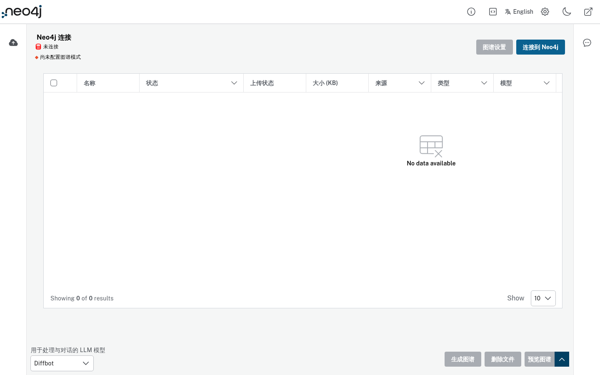

# LLM Graph Builder 文档

从文档构建知识图谱的工具。支持上传 PDF/DOCX/TXT 等，使用 LLM 抽取实体与关系，可视化图谱，并支持 SPARQL 查询。

## 界面预览

## 核心流程

1. **Upload** — 上传文档
2. **Extract** — LLM 抽取实体与关系
3. **Explore** — 图谱可视化与 SPARQL 查询

## 技术特点

- 多格式文档支持
- Neo4j 图谱存储
- 实体详情与关系浏览
- SPARQL 查询界面

## 使用场景

从非结构化文档快速构建可查询的知识图谱。
